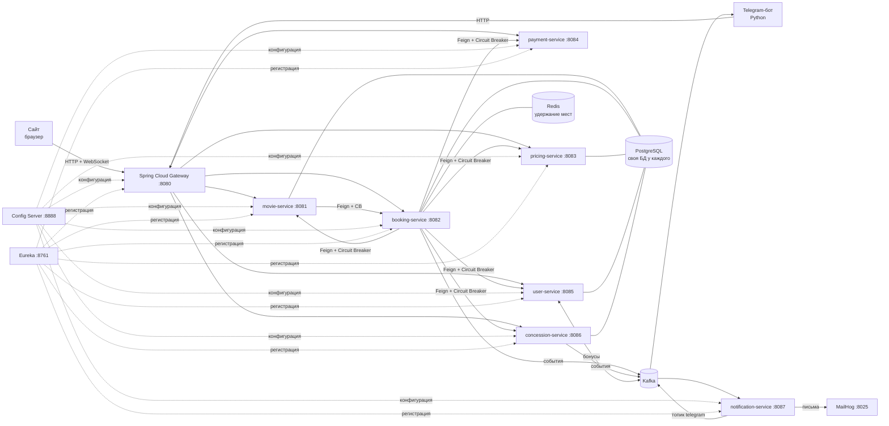

# 🎞 CineFlow — сеть кинотеатров на Spring Cloud

Микросервисное приложение: онлайн-кинотеатр с бронированием мест в реальном времени, сайтом и Telegram-ботом.

## Архитектура

| Требование задания | Где реализовано |
|---|---|
| Минимум 3 микросервиса | 7 бизнес-сервисов + Python-бот |
| Spring Cloud Config | `config-server`, все настройки в папке `config-repo` |
| Eureka | `eureka-server`, все сервисы регистрируются, вызовы по имени `lb://…` |
| API Gateway | `gateway`, маршруты в `config-repo/gateway.yml` |
| * Circuit Breaker | Resilience4j в Gateway (fallback-страница) и в сервисах (`booking-service/client/Remote.java`) |
| * Мониторинг и логирование | Actuator во всех сервисах, логи в консоль и в папку `logs/`, лог каждого запроса в Gateway с `X-Request-Id` |
| * API-документация | Swagger в каждом сервисе + сводный Swagger: http://localhost:8080/swagger-ui.html |

## Запуск

Нужно: **Docker Desktop** (выделите ему 8 ГБ памяти: Settings → Resources) и **VS Code**.

1. Распакуйте архив и откройте папку `cineflow` в VS Code. Согласитесь установить рекомендуемые расширения.
2. Создайте бота: в Telegram напишите [@BotFather](https://t.me/BotFather) → `/newbot` → получите токен.
3. Скопируйте `.env.example` в `.env` и вставьте `BOT_TOKEN` и `BOT_USERNAME` (имя бота без @).
4. В терминале VS Code: `docker compose up --build`
   (или `Ctrl+Shift+P` → *Tasks: Run Task* → «🚀 Запустить всё»).
   Первая сборка скачивает зависимости Maven — 10–15 минут. Потом — 1–2 минуты.
5. Когда в Eureka (http://localhost:8761) появятся все сервисы, открывайте **http://localhost:8080**.

| Что | Адрес |
|---|---|
| Сайт | http://localhost:8080 |
| Swagger всех сервисов | http://localhost:8080/swagger-ui.html |
| Eureka | http://localhost:8761 |
| Config Server (пример) | http://localhost:8888/pricing-service/default |
| Письма с билетами (MailHog) | http://localhost:8025 |
| Actuator | http://localhost:8082/actuator/health, `/metrics`, `/circuitbreakers` |

**Служебные входы** (вход по имени и почте, пароль не нужен): `admin@cineflow.ru` — админка, `control@cineflow.ru` — контроль на входе, `bar@cineflow.ru` — экран бара. Любая другая почта — обычный зритель.

### Разработка в VS Code без Docker для Java
Запустите задачу «🧱 Только инфраструктура», затем в панели *Run and Debug* выберите «▶ Все Spring-сервисы» (или по одному: Config Server → Eureka → остальные). Бот: создайте `telegram-bot/.venv`, `pip install -r telegram-bot/requirements.txt`, конфигурация «Telegram Bot (Python)».

## Фишки и где их смотреть

| № | Фишка | Где в коде |
|---|---|---|
| 1, 12 | Живая схема зала и статистика по WebSocket | `booking-service/live`, `gateway/.../js/hall.js` |
| 2 | Удержание места 5 минут (Redis SET NX + TTL) | `booking-service/service/SeatService.java` |
| 3 | Динамические цены из Config Server | `pricing-service`, `config-repo/pricing-service.yml` |
| 4 | Бар к креслу + экран бара, CB с fallback | `concession-service`, вкладка «Бар» |
| 5 | Бонусы 5/7/10%, начисление по событию Kafka | `user-service/TicketEventsListener.java` |
| 6 | Рекомендации по жанрам или топ недели | `movie-service/service/CatalogService.java` |
| 7 | Админ-аналитика на Chart.js | `booking-service/service/AnalyticsService.java`, «Админка» |
| 8, 29 | Три города, шесть кинотеатров, карта Leaflet | `movie-service/service/DataSeeder.java` |
| 9 | Совместный поход: каждый платит сам | `booking-service/service/GroupService.java` |
| 10 | QR-билет и сканер контролёра (сайт и бот по фото) | `TicketService.scan`, вкладка «Контроль» |
| 11 | Лист ожидания с удержанием места на 10 минут | `booking-service/service/WaitlistService.java` |
| 13 | Промокоды с условиями | `pricing-service`, «Админка → Промокоды» |
| 14 | Отзыв только после прохода по билету | `movie-service/service/ReviewService.java` |
| 15 | Трейлеры | страница фильма |
| 17 | Telegram-бот на Python | папка `telegram-bot` |
| 18 | Письмо с QR-билетом | `notification-service`, MailHog |
| 19 | Тёмная/светлая тема, мобильная версия | кнопка в шапке |
| 20, 32 | Свой курсор и курсоры других зрителей, на телефоне — пульсирующая точка | `effects.js`, `hall.js` |
| 22 | Гаснет свет, раздвигается занавес, печатается билет | `effects.js` |
| 23 | Цвет страницы под постер (ColorThief) | `pages-catalog.js` |
| 25 | «Твой киногод» как Spotify Wrapped | «Профиль → Мой киногод», бот «🎁 Мой киногод» |
| 28 | Киноассистент на правилах | `booking-service/service/AssistantService.java` |
| 31 | «Плёнка оборвалась» + мини-игра при падении сервиса | `effects.js`, `gateway/FallbackController.java` |

Плюс сверх списка: сага оплаты с компенсациями, 100 ботов-зрителей для нагрузочного демо, «кнопка хаоса», живая панель Circuit Breaker'ов, второй экземпляр сервиса с балансировкой через Eureka и рассылкой событий через Redis Pub/Sub.

## Сценарий защиты (7 минут)

1. **Архитектура.** Схема выше + Eureka со всеми сервисами + сводный Swagger.
2. **Живой зал.** Откройте один сеанс в двух браузерах (один — в режиме инкогнито с другим аккаунтом). Видны курсоры друг друга; кресло, выбранное в одном окне, мгновенно занимается в другом.
3. **Покупка.** Промокод `AUTUMN`, баллы, попкорн → гаснет свет → занавес → печатается билет. Через пару секунд билет с QR приходит в Telegram и на почту (MailHog).
4. **100 зрителей.** «Админка → Живое демо» → выбрать сеанс → «Запустить ботов». Зал заполняется на глазах, в конце: конфликтов десятки, **двойных продаж — 0** (Redis SET NX).
5. **Ломаем и чиним.** «Админка → Хаос» → «Упал». Пробуем купить: деньги не списаны, места остаются за зрителем, баллы вернулись (компенсация саги). На панели Circuit Breaker `payment` переходит в **OPEN**. Включаем «Работает» → через 15 секунд HALF_OPEN → CLOSED.
   Затем задача «💥 Уронить бар»: билеты продаются без бара, а экран бара показывает «Плёнка оборвалась».
6. **Конфигурация на лету.** В `config-repo/pricing-service.yml` поменять `banner` или `center-coefficient` → «Админка → Конфигурация → Обновить». Цены и бегущая строка изменились без перезапуска.
7. **Контроль.** Контролёр отправляет боту фото QR: «✅ ПРОХОДИТЕ». Повторно: «⛔ БИЛЕТ УЖЕ ИСПОЛЬЗОВАН». После прохода зрителю приходит кнопка «Оценить фильм».
8. **Финал.** «Профиль → Заполнить демо-историей» → «Мой киногод»: анимированные слайды и карточка для сторис.

Дополнительно: «Полный зал → лист ожидания» (через 2 минуты место уходит первому в очереди с кнопкой «Забрать место» в боте) и «Сеанс через час → напоминание в Telegram».

## Распределение по команде

| Участник | Зона |
|---|---|
| 1 | Инфраструктура: Config, Eureka, Gateway, Docker, мониторинг, логирование |
| 2 | movie-service + pricing-service, ассистент |
| 3 | booking-service: Redis, сага, WebSocket, лист ожидания, аналитика |
| 4 | payment, user, concession, notification, сайт и Telegram-бот |

## Если что-то не работает

- **Сервис перезапускается на старте** — он ждёт Config Server и Kafka, это нормально в первые 1–2 минуты.
- **Не хватает памяти** — увеличьте память Docker Desktop до 8 ГБ.
- **Бот молчит** — проверьте `.env` и логи: `docker compose logs telegram-bot`.
- **Камера сканера не включается с телефона** — браузеры дают камеру только на `localhost` или HTTPS. Используйте бота (фото QR) или `ngrok http 8080`.
- **Карта, графики или шрифты не грузятся** — они подключаются с CDN, нужен интернет на компьютере.
- **Трейлер не открывается** — поменяйте `trailer_youtube_id` у фильма в базе `movie_db` (pgAdmin, таблица `movies`).
- **Начать с чистого листа** — `docker compose down -v`.
